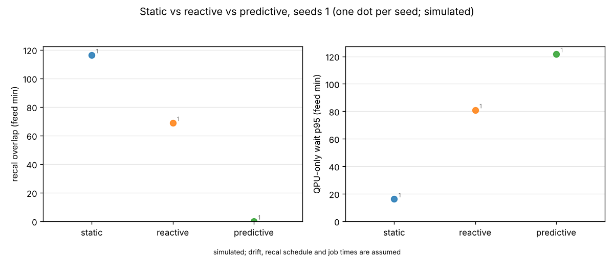

# qpu-aware-scheduling

**Scheduling hybrid quantum-classical jobs on HPC clusters using live QPU state.**

> A scheduler only knows what it's told.

Today Slurm sees a QPU as a counter: 1 or 0. It doesn't know whether the device is mid-recalibration, drifting, or about to go down, so a hybrid job can be handed CPU/GPU nodes for a QPU it can't use yet. This project is an experiment, built in public, in telling the scheduler more, and measuring whether it helps.

Everything here runs on a laptop against a **simulated QPU**. All results are labeled simulated.

## The gap (Week 1 reading)

From the QRMI SPANK plugin source and the docs I read (full sources and commits: [docs/landscape.md](docs/landscape.md)):

| System | How Slurm sees the QPU | Live QPU state that reaches the scheduler |
|---|---|---|
| [QRMI / spank-plugins](https://github.com/qiskit-community/spank-plugins) | `--qpu=` SPANK option mapped to `qrmi_config.json` | Plugin: none. The QPU is checked inside the job *after* nodes are allocated; on failure the job is cancelled |
| [QRMI license poller (reference example)](https://github.com/qrmi-community/slurm_poller_daemon_example) | Slurm dynamic license per backend (`--licenses=`) | Ready/busy only, polled every `poll_interval` s; jobs pend while busy, offline or paused |
| [QDMI (MQT Core docs)](https://mqt.readthedocs.io/projects/core/en/latest/qdmi/slurm.html) | One Slurm license per device | Up/down only, at admission (a documented license monitor) |
| [LRZ / MQSS](https://arxiv.org/abs/2608.14827) | GRES `qpu` + prolog | None in the public code; recal handled by the vendor stack |

I haven't found published work where calibration or recalibration state reaches Slurm placement or backfill as anything more than an up/busy flag (no drift, no recal windows, no prediction). Closest measured work: [Rocco et al., QCE25](https://arxiv.org/abs/2508.04217) cuts classical node-seconds vs static allocation on Slurm by releasing nodes per job phase, not QPU state. If you know of more, please open an issue.

## What works today

- **Week 0:** Local Slurm cluster ([slurm-docker-cluster](https://github.com/giovtorres/slurm-docker-cluster), Slurm 26.05.2) on an M1 Mac. Slurm sees 8 CPUs on a 4-CPU VM, so 8 concurrent jobs ran **2.16x** slower than one. The scheduler trusts what nodes report.
- **Fake `qpu` GRES + contention test:** 3 jobs requesting `--gres=qpu:1` on 2 QPUs. Two run, and the third pends on `Resources` while both nodes have 3 idle CPUs. The QPU is the only thing blocking it.

Details, numbers and bugs hit along the way: [DEVLOG.md](DEVLOG.md).

## Results (simulated)

Three policies on the Docker cluster (Slurm 26.05.2), 5 seeds each, from [results/sweep_table.md](results/sweep_table.md) and [results/sweep_summary.csv](results/sweep_summary.csv):
- **static:** the QPU is never taken out.
- **reactive:** HRES-like; takes a node's QPU out while it recalibrates.
- **predictive:** reactive, plus a QPU job starts only if its time limit ends before that QPU's next recal.

**All of this is simulated.** QPUs are GRES counters, jobs run on Aer, and the calibration feed is simulated at 36× (1 wall s = 0.6 feed min). Drift, the recal schedule and job times are assumed.

**The predictive policy reads the exact recal start.** The feed's jitter is applied before `next_recal.start` is published, so the published start is when the recal really begins. Predictive's 0 overlap therefore holds by construction under an exact forecast. It is not evidence about real recal forecasts.

For seed N, every policy uses workload seed N and feed seed 100+N, with a byte-identical job manifest. Values are median across seeds [min–max], in feed minutes.

| Metric | static (seeds 1,2,3,4,5) | reactive (seeds 1,2,3,4,5) | predictive (seeds 1,2,3,4,5) |
|---|---|---|---|
| Recal-overlap jobs | 6 [3–8] | 2 [1–3] | 0 [0–0] |
| Recal overlap (feed min) | 116.4 [75–185.4] | 67.2 [21–96.6] | 0 [0–0] |
| QPU-only wait median (feed min) | 0 [0–0.3] | 0 [0–10.2] | 2.4 [1.5–30.6] |
| QPU-only wait p95 (feed min) | 24.6 [1.8–32.4] | 31.2 [3–81] | 121.8 [33–175.8] |
| Hybrid wait p95 (feed min) | 9 [1.2–46.2] | 17.4 [1.2–46.2] | 130.8 [23.4–161.4] |
| Classical wait p95 (feed min) | 1.8 [0.6–12] | 1.8 [0.6–14.4] | 10.8 [1.8–13.2] |
| Completion median (feed min) | 23.1 [15–39.6] | 24 [16.2–44.4] | 32.4 [20.4–48.6] |
| Completion p95 (feed min) | 117 [79.2–144.6] | 117 [82.2–144.6] | 172.8 [118.2–223.8] |
| Submit rejections | 0 [0–0] | 0 [0–1] | 0 [0–0] |
| Gate: jobs kept held at least once | 0 [0–0] | 0 [0–0] | 6 [2–7] |
| Gate: re-holds | 0 [0–0] | 0 [0–0] | 0 [0–1] |

All jobs completed in all 15 runs.

**Recal overlap per seed** (feed min, static → reactive → predictive): seed 1: 116.4 → 69 → 0; seed 2: 91.8 → 67.2 → 0; seed 3: 185.4 → 65.4 → 0; seed 4: 75 → 21 → 0; seed 5: 127.8 → 96.6 → 0.

- **p95 is one job here.** p95 is the value at index int(0.95·n), so for n ≤ 20 it equals the maximum. QPU-only n = 12–19 and hybrid n = 5–13 per seed.
- **The cost of predictive vs reactive varies a lot by seed.** QPU-only wait p95 is 1.5–11× reactive's, hybrid 1.3–109× (the 109× is seed 5, where hybrid n = 5). One multiplier would hide that spread.
- **Submit rejections aren't comparable across policies:** held submits are accepted while every QPU is out.
- **Trade:** per seed, the extra QPU+hybrid queue wait predictive adds is 3.9–13.4× the recal overlap it saves vs reactive, and 2–8.7× vs static. That compares QPU-recal minutes with queue-wait minutes; it isn't a cost model. Per-seed numbers: [results/trade_table.md](results/trade_table.md).

How it's measured, and the limits: [policy/README.md](policy/README.md) and [DEVLOG.md](DEVLOG.md) (2026-11-22 and 2026-11-23).

## Roadmap

- [x] Week 0: Slurm internals, overcommit test, fake `qpu` GRES
- [x] Week 1: Landscape: where QPU state does and doesn't enter scheduling
- [x] Week 2: Cluster in this repo (`docker compose up`) + a Qiskit Aer job through `--gres=qpu:1`
- [ ] Week 3: QRMI against a simulator + a simulated calibration/recal feed
- [ ] Week 4: Static-allocation baseline: classical node-seconds idle, queue wait, QPU utilization (3 seeded runs)
- [ ] Week 5: State-aware policy (`job_submit` Lua, external scheduler as fallback)
- [ ] Week 6: One chart, one table, limits written down; open an upstream discussion

## Repo layout

- `cluster/`: the Docker Slurm cluster with a `qpu` GRES
- `feed/`: the simulated QPU calibration feed
- `jobs/`: simulated Aer jobs through `--gres=qpu:1`
- `policy/`, `workload/`: the static, reactive and predictive policies, the seeded workload and the sweep runner (`make sweep SEEDS="1 2 3 4 5"`)
- `results/`: per-run outputs (`results/<policy>/seed<N>/`) and the sweep table and chart
- `docs/landscape.md`: where QPU state does and doesn't reach the scheduler
- `experiments/week0/`: overcommit test, GRES patch, sbatch scripts
- `DEVLOG.md`: what I ran, what I saw, what broke

## Reproduce Week 0

See [experiments/week0/README.md](experiments/week0/README.md). You need Docker and a clone of slurm-docker-cluster; apply `gres-qpu.patch` for the `qpu` GRES.

## Follow along

Weekly build logs on X: [@arshmalik02](https://x.com/arshmalik02). Issues and corrections welcome.

## License

See [LICENSE](LICENSE).
